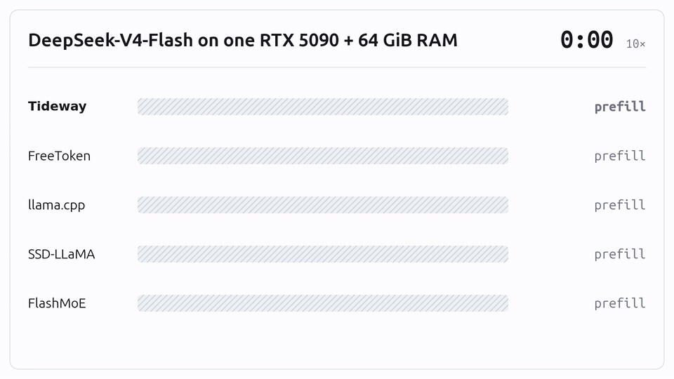
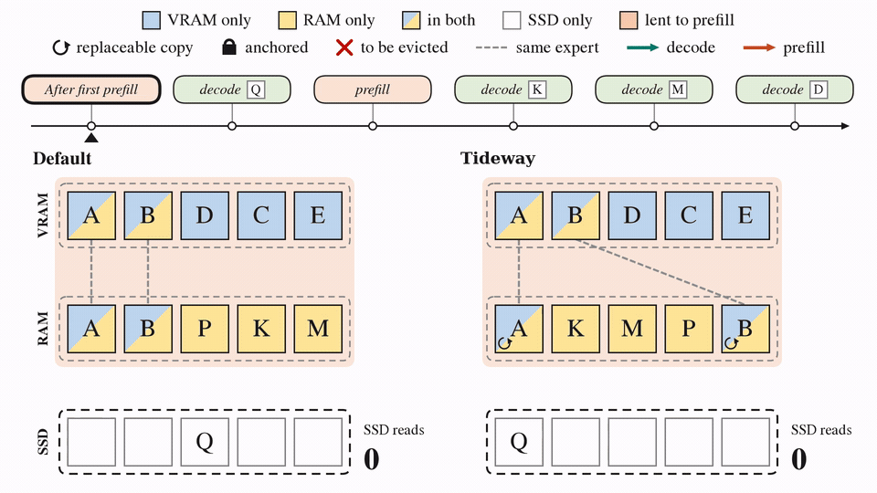
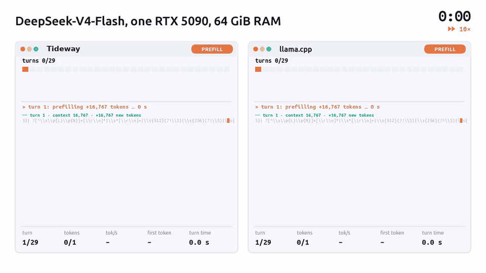
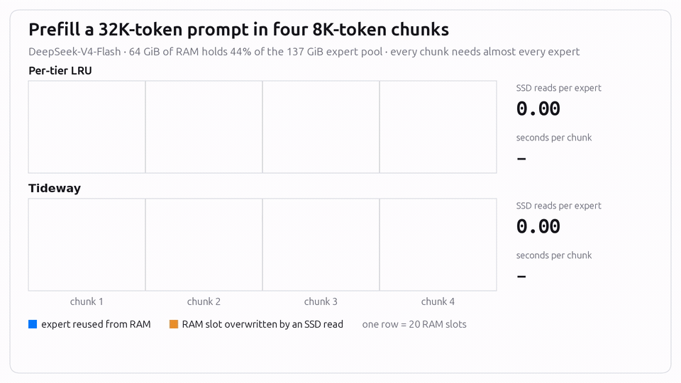

<p align="center">
  <picture>
    <source media="(prefers-color-scheme: dark)" srcset="docs/assets/logo-dark.svg">
    
  </picture>
</p>

<p align="center">
  <b>Phase-aware tiered memory management for MoE inference on consumer devices</b>
</p>

<p align="center">
  <a href="LICENSE"></a>
  <a href="https://arxiv.org/abs/2611.14848"></a>
</p>

<p align="center">
  <a href="https://arxiv.org/abs/2611.14848">Paper</a> ·
  <a href="#getting-started">Getting started</a> ·
  <a href="#how-it-works">How it works</a> ·
  <a href="#demos">Demos</a> ·
  <a href="docs/usage.md">Runtime guide</a> ·
  <a href="baselines/README.md">Baselines</a>
</p>

<p align="center">
  <a href="docs/media/request-race.mp4"></a>
</p>
<p align="center">
  <em>Measured replay of a single DeepSeek-V4-Flash request at 10× playback (<a href="docs/media/request-race.mp4">watch the full recording</a>).</em>
</p>

## Overview

**Tideway** runs frontier Mixture-of-Experts (MoE) models on consumer PCs by coordinating **GPU VRAM, host RAM, and NVMe SSD** as a unified, phase-aware memory hierarchy. On memory-constrained desktops, massive MoE weights inevitably spill across all three tiers, putting dynamic expert transfers directly on the critical path. Existing engines treat each tier as an isolated cache with a static layout—suffering from severe SSD scan thrashing during prefill and falling back to high-overhead eager execution upon expert misses during decode. Tideway addresses both bottlenecks by coupling a **Cross-Tier Memory Manager** with a **Paging-Aware Execution Engine**, dynamically adapting memory layouts across inference phases while sustaining graph-based GPU execution under expert paging.

Evaluated on an NVIDIA RTX 5090 (32 GB VRAM) with 16–128 GiB of host RAM across **Qwen3.6-35B-A3B** (BF16), **Gemma4-26B-A4B** (BF16), and **DeepSeek-V4-Flash** (FP4), Tideway outperforms state-of-the-art baselines by an average of **1.97×** (up to **3.18×**) in end-to-end latency, **2.40×** (up to **9.04×**) in TTFT, and **1.61×** in TPOT, while accelerating multi-turn coding-agent sessions on TraceLab by up to **3.14×**.

<table>
  <thead>
    <tr>
      <th rowspan="2" width="25%" align="left">Model</th>
      <th rowspan="2" width="15%" nowrap>Host RAM</th>
      <th colspan="4">Speedup over the fastest baseline</th>
    </tr>
    <tr>
      <th width="15%" nowrap>End-to-end<br>fixed-shape</th>
      <th width="15%" nowrap>End-to-end<br>TraceLab</th>
      <th width="15%" nowrap>TTFT<br>TraceLab</th>
      <th width="15%" nowrap>TPOT<br>TraceLab</th>
    </tr>
  </thead>
  <tbody>
    <tr><td rowspan="3"><b>Qwen3.6&#8209;35B&#8209;A3B</b> BF16&nbsp;·&nbsp;67&nbsp;GiB</td><td align="center" nowrap>64 GiB</td><td align="center">1.13×</td><td align="center">1.20×</td><td align="center">1.17×</td><td align="center">1.20×</td></tr>
    <tr><td align="center" nowrap>48 GiB</td><td align="center">3.10×</td><td align="center"><b>3.14×</b></td><td align="center"><b>9.04×</b></td><td align="center">1.89×</td></tr>
    <tr><td align="center" nowrap>32 GiB</td><td align="center">1.95×</td><td align="center">2.04×</td><td align="center">2.56×</td><td align="center">1.45×</td></tr>
    <tr><td rowspan="3"><b>Gemma4&#8209;26B&#8209;A4B</b> BF16&nbsp;·&nbsp;48&nbsp;GiB</td><td align="center" nowrap>48 GiB</td><td align="center">1.32×</td><td align="center">1.51×</td><td align="center">1.70×</td><td align="center">1.20×</td></tr>
    <tr><td align="center" nowrap>32 GiB</td><td align="center"><b>3.18×</b></td><td align="center">1.47×</td><td align="center">1.45×</td><td align="center">1.48×</td></tr>
    <tr><td align="center" nowrap>16 GiB</td><td align="center">2.72×</td><td align="center">2.66×</td><td align="center">2.05×</td><td align="center"><b>2.28×</b></td></tr>
    <tr><td rowspan="3"><b>DeepSeek&#8209;V4&#8209;Flash</b> FP4&nbsp;·&nbsp;155&nbsp;GiB</td><td align="center" nowrap>128 GiB</td><td align="center">1.58×</td><td align="center">1.31×</td><td align="center">1.15×</td><td align="center">1.36×</td></tr>
    <tr><td align="center" nowrap>96 GiB</td><td align="center">2.63×</td><td align="center">1.64×</td><td align="center">1.76×</td><td align="center">1.50×</td></tr>
    <tr><td align="center" nowrap>64 GiB</td><td align="center">1.98×</td><td align="center">1.69×</td><td align="center">1.36×</td><td align="center">1.93×</td></tr>
  </tbody>
</table>

## How it works

Tideway co-designs three core mechanisms across the memory hierarchy:

1. **[Unified memory pool & replica-aware replacement](src/tideway/offload/runtime.py):** Instead of maintaining redundant copies across independent caches, Tideway manages GPU VRAM and host RAM as a single pool backed by the SSD. When allocating space, Tideway reclaims redundant cross-tier copies first and selectively demotes evicted GPU-only experts back to RAM over idle bidirectional PCIe links—maximizing distinct expert coverage and minimizing costly SSD reloads.
2. **[Phase-aware memory layouts](src/tideway/offload/phase_policy.py):** Because prefill and decode exhibit starkly different access patterns, Tideway switches the pool's layout at each phase boundary. During prefill, it borrows VRAM for double-buffered weight streaming, **anchors** reusable RAM-resident experts against full-model scan eviction, and cycles SSD-backed weights through a compact streaming window. During decode, it releases the anchors and reclaims the borrowed VRAM as fixed-address expert cache slots.
3. **[Paging-aware execution](src/tideway/offload/paged_decode_graph.py):** To keep the GPU saturated while experts move across tiers, Tideway pairs a **streaming prefill pipeline**—overlapping layer $l+1$ weight delivery with layer $l$ computation—with **piecewise CUDA Graphs** during decode. By isolating host-driven paging between captured graph segments, Tideway dynamically fetches missing experts into fixed VRAM slots while retaining low-overhead CUDA Graph replay without recapturing.

The animation below traces expert residency through a prefill–decode sequence under default per-tier LRU and under Tideway, which cuts SSD reads from **9 to 6**:

<p align="center">
  <a href="docs/media/phase-aware-layout.mp4"></a>
</p>

## Getting started

**Requirements:** Linux · Python 3.12+ · NVIDIA GPU · CUDA 13 toolkit · GCC

```bash
git clone https://github.com/Afterglow231/Tideway.git
cd Tideway
python3.12 -m venv .venv
source .venv/bin/activate
python -m pip install -e .
python scripts/build_backend.py
```

Activate the assembled backend **before importing FreeToken**:

```python
from tideway import activate_backend

activate_backend()

from freetoken.llm import LLM
```

> [!NOTE]
> Model checkpoints are supplied separately. See the [runtime guide](docs/usage.md)
> for engine integration, expert capacities and build-directory settings.

## Baselines

| Baseline | Implementation |
|---|---|
| **FreeToken** | FreeToken 0.1.2, with an independent RAM LRU and demand SSD paging when the expert pool does not fit in RAM. |
| **llama.cpp** | Pinned upstream runtime with RSS-governor and token-replay libraries. |
| **SSD&#8209;LLaMA** | Frequency-recency GPU retention and rANS-compressed expert records. |
| **FlashMoE** | Trained per-layer replacement and raw checkpoint paging. |

SSD-LLaMA and FlashMoE are independent implementations of the published mechanisms.
[Baseline APIs and commands](baselines/README.md) cover expert-pack preparation,
predictor training and llama.cpp setup.

## Demos

<details>
<summary><b>29-turn agent session</b></summary>



Session S09 · Tideway vs. llama.cpp · measured replay at 70× playback.

[Download MP4](https://github.com/Afterglow231/Tideway/raw/refs/heads/main/docs/media/agent-session.mp4)

</details>

<details>
<summary><b>Expert residency</b></summary>



A 32K-token prefill in four 8K-token chunks, comparing per-tier LRU with Tideway.

[Download MP4](https://github.com/Afterglow231/Tideway/raw/refs/heads/main/docs/media/expert-residency.mp4)

</details>

## Documentation

- [Runtime guide](docs/usage.md): backend selection, memory capacities and engine integration.
- [Baseline reference](baselines/README.md): APIs, pack preparation and predictor training.
- [Demo media](docs/media/README.md): recordings, playback rates and regeneration.

<details>
<summary>Repository layout</summary>

```text
src/tideway/                  Memory planning, KV sharing, kernels and execution hooks
src/tideway/offload/          Expert readers and paging-aware execution
src/tideway/baselines/        Baseline adapters and expert transport
backends/freetoken_tideway/   Checked FreeToken 0.1.2 source overlay
baselines/llama_cpp/          Pinned llama.cpp build and preload libraries
scripts/                      Backend, baseline and media preparation tools
docs/usage.md                 Runtime integration guide
docs/media/                   Demo videos, GIFs and posters
```

</details>

## Citation

If you find Tideway helpful in your research, please consider citing our paper:

```bibtex
@misc{wang2026tidewayphaseawaretieredmemory,
  title         = {Tideway: Phase-Aware Tiered Memory Management for MoE Inference on Consumer Devices},
  author        = {Yifei Wang and Tsun-yu Yang and Yechen Xu and Hancheng Ye and
                   Qinsi Wang and Baijun Zhou and Tingjun Chen and Hai "Helen" Li and
                   Danyang Zhuo and Yiran Chen},
  year          = {2026},
  eprint        = {2611.14848},
  archivePrefix = {arXiv},
  primaryClass  = {cs.OS},
  url           = {https://arxiv.org/abs/2611.14848}
}
```

## Acknowledgements

We gratefully acknowledge the authors of *FreeToken* and *FlashInfer* for their
open-source code. Visit the following links for more of their contributions.

- [FreeToken](https://github.com/FlashML-org/FreeToken)
- [FlashInfer](https://github.com/flashinfer-ai/flashinfer)
